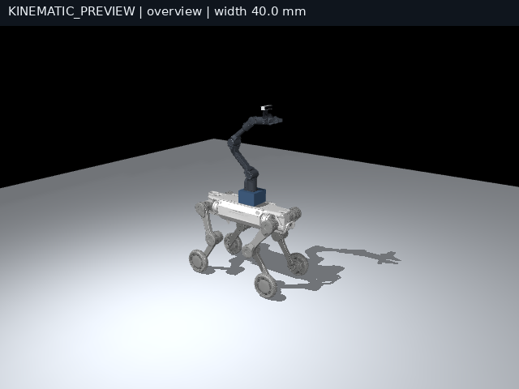

# dog-and-arm：M1＋Piper H 腿臂协同控制

## 2026-11-25｜RefXY2 已执行结案，默认入口为查看已有视频

两支各保留 +200 Actor / +2,000 WM / +4,000 Critic，配对实付 400 / 4,000 / 8,000，回滚为零。主段 252 案，延长复测 12 案。native/pull 的处理支最小 P95 为 10.255 mm，超过 shared_0 最大 P95 9.910 mm，差 0.345 mm。登记的 native 非退化条件未满足。本轮于 +200 结案，RefXY2 完整成功 0/12，V0=0，合格双侧回报 NA。

本聊天显式启动的配对与视频收束工作并行。登记提交为 2bbb9fec，交付基于含视频说明的 de0a4d6c。项目默认继续查看已有 546 维混合策略的双侧视频，后续研究等待另行指定。原 standard-v1 封存于 u10000。

[独立配对实测](reports/B0_REFXY2_TRANSFER_RESULTS_20261125.md) · [逐案与视频清单](results/b0/refxy2_pair_20261125/assessment/physics_manifest.json) · [已有双侧成功视频](reports/SUCCESS_VIDEOS_AND_SCOPE_20261125.md)

## 2026-11-25 18:21｜视频交付范围：已有完整成功视频，停止自动推进标准迁移

用户现在以“能查看比较完整的成功流程仿真视频”为当前收束依据。已核对同一个546维混合策略u1的native双侧原视频：前拉74.28s、背推54.44s，均从frame0连续完成13阶段，原判passed=true。方法含参考前馈、累计15000动作BC及解析补偿；原官方标准链仍未完成，不能混写身份。

[立即查看视频与说明](reports/SUCCESS_VIDEOS_AND_SCOPE_20261125.md) · [视频核验清单](results/b0/success_video_review_20261125/manifest.json) · [当前入口](prompts/NEXT_RUN.txt)

**停止继续自动安排SuperMimic标准迁移；RefXY2计划保留但不启动，原u10000封存。** 原B0-04/null/NA/标准V0=0作为未完成结论保留，不再为本次视频交付追加训练或D/C/seed/H。当前先交付并查看已有成果，后续研究待用户另行指定。本次新增训练/仿真0，没有检查或终止远端未知作业。下方旧“下一轮执行”属于历史，不能覆盖本节。

## 2026-11-25｜当前入口：RefXY2 独立配对已登记，尚未执行

787d5e38 的 A–D 已完成并复核。原平台四案位置合格 0 拍、ready 0/75，最近 7.933–13.826 mm；不存在已证明可直接修复的同契约反例，但原 H32 同一 WM 的 9 组 AD–割线反号仍未闭合。原 standard-v1/u10000 保持 B0-04、候选 null、合格双侧回报 NA、V0=0，Warp/native 接触各 0/10、full 0/4、free 0/60。

[当前审查](reports/B0_PREGRASP_ROUND_REVIEW_20261125.md) · [下一配对计划](docs/B0_REFXY2_TRANSFER_PLAN_20261125.md) · [机器登记](results/b0/pregrasp_review_20261125/next_registration.json) · [目标差距](docs/GOAL_GAP_20261125.md) · [启动词](prompts/NEXT_RUN.txt)

下一执行轮为独立 `SuperMimic-M1Piper-RefXY2-v1` 与等宽恒零控制：完整恢复同一 u10000，仅 Actor 增当前参考根相对自身的 XY2；保留 `execution_recipe=official_flow_s0_v1` 与原 WM/Critic/损失/Ratio/H32/物理/裁判。各 +200，双侧原物理证据支持时同轮同步 +1000。主段实际优化上限 420/4200/8400，延长总上限 2020/20200/40400；全轮共享回滚20/200/400。主段三套原评分252案，完整延长440案，条件资格另列。一次冻结FP64模型内复核并行，不作WM门。

本次只完成审查和计划发布，没有新增训练或仿真。新两维改变Actor信息，结果独立标识，不能改写原标准成功；先迁移冻结，再开发算法/VLA。首个原判完整成功立即交同回合原速V0。以下旧“当前/下一轮/待决定”均按历史日期及当时提交阅读，A–D和原u15000不重复启动；当前执行范围以本节、新计划及启动词为准。

## 2026-11-25｜u10000 预抓兼容性实测

原预抓平台四案均有连续 76 拍姿态合格，位置为 0 拍，最近 7.933–13.826 mm。四个锚点确认 Actor 的水平平移输入别名。76 条 0.25 ms 闭环响应均走完 H32；沿原目标正向扰动首动作，真实同钟和端点误差同时改善 3/12。四案超时后按原参考钟继续均未建立双指接触，在参考 open 阶段触发原物理终止。 standard-v1 仍为 B0-04、候选 null、合格双侧回报 NA、V0=0。u10000 原 Warp/native 接触各 0/10、full 0/4、free 0/60。新增优化 Actor/WM/Critic 为 0/0/0。原主链封存于 u10000。

[独立实测报告](reports/B0_PREGRASP_COMPATIBILITY_RESULTS_20261125.md) · [机制决定](results/b0/standard_pregrasp_compatibility_20261125/mechanism_decision.json) · [实际成本](results/b0/standard_pregrasp_compatibility_20261125/budget_and_recovery.json) · [诊断视频](results/b0/standard_pregrasp_compatibility_20261125/diagnostic_video_manifest.json)

## 2026-11-25｜u10000 已审查，下一轮集中查明预抓失败

固定79fd3cf的official_flow_s0_v1已结案于u10000，不延长u15000。末点原Warp/native接触各0/10，frame0完整0/4、free0/60；候选null、合格完整双侧回报NA、V0=0，仍B0-04。主链累计10000 Actor/100000 WM/200000 Critic、102414758有效转移。先完成固定官方标准迁移冻结，再开发算法/VLA。

[最新审查](reports/B0_U10000_REVIEW_20261125.md) · [下一集中轮](docs/B0_PREGRASP_COMPATIBILITY_PLAN_20261125.md) · [机器登记](results/b0/official_u10000_review_20261125/next_registration.json) · [目标差距](docs/GOAL_GAP_20261125.md) · [启动词](prompts/NEXT_RUN.txt)

预抓末拍79–113mm是到冻结端点的距离；同时TCP距把手7.84–11.51mm，参考已到grasp。下一轮围绕原平台期一次完成既有12轨迹分解、冻结输入/原目标核对、有限动作响应及4条完整参考钟诊断。默认0优化；仅有具体实现错误时同轮最小修复、control/fix各200原更新，另列一次回滚预留。原主链结案、旧结果与预算保持，不自动换观测/奖励、暂停参考或重开WM门。

本次是仓库审查与计划发布，未新增训练/仿真。后续首次原裁判完整成功立即交同episode连续原速V0；失败后延续诊断视频不能代替成功视频。下方旧“当前/下一轮”按相应日期的历史记录阅读，以本节和新登记为当前入口。

**基础联合模型已生成：官方 M1 ZGWS＋Piper H＋双指夹爪＋名义腕部支架／相机。**提供可重建的组合 URDF/MJCF、桌面实时关节调试入口和被动单门组合场景。装配查看器仍是 **KINEMATIC_PREVIEW**；另有独立 P4 入口，固定底盘已从前侧拉门至 **59.963°**，从背侧推门至 **25.076°**。

**P6 自由底盘单门。** 安装板、两侧支座和 Piper H 沿机身前移 60 mm。采用 `rail_bridge_front60_v2` 和冻结控制 `86ade86`，本机 Linux 桌面复测前拉 60°、背推 25° 各 20/20 通过。初版背推 C20 驶近时左后轮碰柱，调整背侧航向后重跑整侧。旧版成绩和失败保存在分版本报告中。[完整结果](reports/P6_FREE_BASE_DOOR.md) · [逐案数值](results/p6/rail_bridge_front60_v2_20261120T133724Z/conditions.csv) · [桌面装配](docs/MOUNT_RAIL_BRIDGE.md)

自由底盘可用 `bash scripts/project_env.sh python scripts/p5_free_base.py --config config/p5_heading.yaml --live --video --hold-final` 查看站立、慢行、按 12° 航向转弯、伸臂行走和停车。 [P5 报告](reports/P5_FREE_BASE.md)

本机桌面装配检查已完成，并已显示 P4 固定基座动力学运行。结果和边界见 [P4 接触报告](reports/P4_FIXED_BASE_CONTACT.md)、[26 秒视频](results/p4/pull_20deg/contact.mp4) 和 [时序图](results/p4/pull_20deg/contact_timeseries.png)。实时装配说明见 [LIVE_DEBUGGING.md](docs/LIVE_DEBUGGING.md)。

生成过程、数值检查和限制见 [装配报告](reports/assembly_report.md)。

**2026-11-16 已完成 H0：Piper H＋DaBai DC1 实机联调。**已保存真实 RGB、原始深度、两路 CameraInfo、静止/慢动作/停止/夹爪联合记录，并验证相机正常重启。最终 240 s 静止记录约 30 Hz 图像、200 Hz 关节反馈；成功动作实测 J6 范围 1.962°。首次失败及后续 QoS/DDS 修正、RGB 畸变参数限制均见 [H0 报告](reports/H0_HARDWARE_REPORT.md) 和 [动作短片](results/hardware/h0/20261116_2051/evidence/motion_success/clip.mp4)。手眼与附件称重仍后置。

## 从创建文件夹开始

在 Linux 终端执行：

    mkdir -p "$HOME/robotics"
    cd "$HOME/robotics"
    git clone https://github.com/kaiwen123-yang/dog-and-arm.git
    cd dog-and-arm
    env -u PYTHONPATH -u PYTHONHOME /usr/bin/python3 scripts/init_workspace.py

接着在本目录打开 Codex，先读 **PROJECT_STATE.md** 和 **prompts/NEXT_RUN.txt**。当前标准迁移审查见 **reports/B0_OFFICIAL_FLOW_ROUND_REVIEW_20261124.md**，工程教师基准见 **reports/P6_FREE_BASE_DOOR.md**；H0 操作流程保留在 **docs/H0_RUNBOOK.md**。已有 Codex CLI 时可运行：

    codex

也可在 VS Code 打开此文件夹并使用已有 Codex 扩展。无需更换现有 Codex 配置。AGENTS.md 会提供项目规则，PROJECT_STATE.md 负责保存实际进度；后者是项目约定文件，需要按提示词读取。

如果本地已经有这个仓库，进入已有目录，查看 git status 后正常拉取和接着工作；不要再次 clone 到同名目录，也不要覆盖已有修改。

## 用户现在需要做什么

正常 fetch main，读取工作树状态并保留现有修改，将 [B0_START.txt](prompts/B0_START.txt) 交给执行端。按[续训计划](docs/B0_OFFICIAL_FLOW_CONTINUATION_PLAN_20261124.md)从u1000完整恢复，集中完成预算内实际训练、有限诊断、固定物理评测、可用完整视频与发布；不只再交一份审计。

现场 /root/autodl-tmp/dog-and-arm-b0-temporal-v1/.official-flow-695f3d7，父包 results/raw_large/b0/official_flow_20261124/resume_001000。官方来源和映射见[对齐清单](docs/B0_OFFICIAL_FLOW_ALIGNMENT_20261124.md)，正式成绩和视频定义见[协议](docs/B0_PAPER_BASELINE_PROTOCOL.md)与[视频/比例协议](docs/B0_FULL_TASK_VIDEO_PROTOCOL.md)。[NEXT_RUN](prompts/NEXT_RUN.txt)与完整启动词一致。

## H0：相机和机械臂联合运行

详细方案见 [HARDWARE_INTEGRATION.md](docs/HARDWARE_INTEGRATION.md)，启动提示词见 [HARDWARE_INTEGRATION.txt](prompts/HARDWARE_INTEGRATION.txt)。本轮按“复用原有环境→相机取流→静止联合采集→已有控制方式的小幅慢动作/夹爪变化→重启采集与报告”完成。

相机/状态采集与运动控制分开运行，保持唯一命令发送端；复用已有 pyAgxArm 接口，不重验机械臂、不自动运行旧完整抓放或 CPV demo。记录 RGB、原始深度、两路 CameraInfo、关节/夹爪反馈及时间信息。软件时间关联、手眼标定和视觉闭环分别记录。

H0 的实际接口已填入 `config/hardware_session.yaml`，结果位于 `results/hardware/h0/20261116_2051/evidence/`。成功动作记录含修正前的 RGB 成批到达，最终 DDS 配置只完成静止复核；不宣称硬件同步或新标定。复跑入口、进程分离及完整本地大录制的范围见 [H0_RUNBOOK](docs/H0_RUNBOOK.md)。

## Codex 模型首轮要完成什么

1. 检查实际 Linux/Python/ROS 环境，在项目 .venv 安装 MuJoCo 依赖。
2. 获取固定来源的 M1 ZGWS 和 Piper H 官方模型，生成源模型清单。
3. 处理 mesh 路径、M1 衍生 URDF 和 Piper 夹爪结构。首版 Piper visual 明确复用官方 collision STL，未转换 DAE 材质外观。
4. 根据官方几何与四张照片完成名义装配，生成组合 URDF 和 MJCF。
5. 交付整机正面、侧面、腕部局部与虚拟相机图；给出模型查看命令。

阶段说明见 docs/BUILD_PLAN.md，转换细节见 docs/MODEL_INTEGRATION.md，已核对的官方来源见 docs/SOURCES.md。

## 已有脚本与运行顺序

以下命令通常由 Codex 执行并处理真实报错；也可以在读完说明后手动运行：

    bash scripts/setup_env.sh
    bash scripts/project_env.sh .venv/bin/python scripts/fetch_sources.py
    bash scripts/project_env.sh .venv/bin/python scripts/inspect_sources.py
    bash scripts/project_env.sh .venv/bin/python scripts/build_assembly.py --stage all
    bash scripts/project_env.sh .venv/bin/python scripts/check_assembly.py
    bash scripts/project_env.sh .venv/bin/python scripts/live_assembly.py --watch

在 MuJoCo 窗口中：左右方向键选择关节，上下方向键微调；空格开合夹爪；F6 检查视角；F8 腕部/自由视角；F9 外观/碰撞专用凸包视图；F10 重载；F11 回到仿真 home；F12 退出。终端显示当前选择和数值。`--watch` 在 XML 成功重新生成后重开查看器；XML 修改失败会保留旧模型。

`config/assembly.yaml` 是安装关系入口。在另一终端修改参数后运行 `build_assembly.py --stage combined`；运行中的查看器会更新。只改 YAML 而不重建 XML 不会改变画面。

单体实时查看分别加 `--model sim/scenes/m1_preview.xml` 或 `--model sim/scenes/piper_preview.xml`；带静止被动单门的整机场景为 `sim/scenes/assembly_with_door.xml`。完整逐阶段流程见实时调试文档。

可选的运动学演示和离线证据：

    bash scripts/project_env.sh .venv/bin/python scripts/live_assembly.py --scripted-demo
    MUJOCO_GL=egl bash scripts/project_env.sh .venv/bin/python scripts/capture_assembly.py --video

二者都不调用 `mj_step`。离线图片／视频不能替代用户本机的实时开窗检查。

P4 固定基座接触复跑（仅仿真，默认保存到新的时间目录）：

    bash scripts/project_env.sh python scripts/p4_fixed_door.py --live --video

结果目录中的 `timeseries.csv` 可由 `scripts/plot_p4.py <结果目录>` 绘图。P4 场景使用独立固定根和专用把手高度；不代表 M1 具有站立控制。

原有被动门入口仍保留：

    bash scripts/project_env.sh .venv/bin/python scripts/build_doors.py
    bash scripts/project_env.sh .venv/bin/python scripts/view_model.py sim/scenes/door_single.xml

查看双门：

    bash scripts/project_env.sh .venv/bin/python scripts/view_model.py sim/scenes/door_double.xml

view_model.py 默认只做静态显示和 mj_forward，不运行无控制的整机动力学。显式添加 --simulate 才进行 mj_step。场景中的门是被动铰链，初始静止；门不会自行打开。

已用 MuJoCo 3.3.0 编译单门/双门，并分别从静止步进 2 s。下面是双门静态渲染，完整验证边界见 [准备验证记录](reports/KICKOFF_VALIDATION.md)。

无桌面环境时，可尝试显式选择本机可用的 EGL 渲染：

    MUJOCO_GL=egl bash scripts/project_env.sh .venv/bin/python scripts/view_model.py sim/scenes/door_double.xml --snapshot results/doors/double_closed.png

该截图命令不运行动力学。若本机 EGL 不可用，根据实际驱动报错处理，或使用桌面查看器；不要为此重装已有 CUDA/ROS。

## 目录用途

| 目录/文件 | 内容 |
| --- | --- |
| AGENTS.md | Codex 项目规则与用户偏好 |
| PROJECT_STATE.md | 当前完成情况、验证范围及下一步 |
| DAILY_WORK_LOG.md | 北京时间逐日详细工作、问题处理、实验结果与交接记录 |
| docs/B0_DYNAMICS_TRAINING_PLAN_20261124.md | 当前集中计划：物理步长、C20统计适配、有限H32与原完整验收 |
| reports/B0_DYNAMICS_ROUND_REVIEW_20261124.md | 870796a审查：联合WM漂移、真实接触覆盖、物理饱和与结果更正 |
| docs/B0_JOINT_CONTACT_PLAN_20261124.md | 下一轮联合分布预适配、原H32单链与完整验收 |
| reports/B0_TEMPORAL_ROUND_REVIEW_20261124.md | ff2d1e8审查：C20原损失折中、T2失稳、数据/物理资格与执行出口 |
| results/b0/temporal_review_20261124/audit_summary.json | 当前十案/预算/抽样复算、代数与计划边界 |
| docs/B0_TEMPORAL_COMPATIBILITY_PLAN_20261124.md | 已执行C20/T2时间配对计划及封存回执 |
| reports/B0_RESPONSE_ROUND_REVIEW_20261124.md | 753f1bc轮审查：数据已贯通、q/v兼容、solver疑点和梯度解释边界 |
| results/b0/response_review_20261124/audit_summary.json | 历史753f1bc独立60案、预算/抽样复算与证据范围 |
| docs/B0_CONTACT_RESPONSE_PLAN_20261124.md | 已执行：训练首动作响应、WM数据持续保留、原目标诊断与真实联合训练 |
| reports/B0_LANES_ROUND_REVIEW_20261124.md | 27284e2轮逐案/预算复算、数据断点、首响应与判定身份审查 |
| docs/B0_STANDARD_TRANSFER_PLAN_20261124.md | 已执行逐lane轮的历史计划与回执 |
| reports/B0_STANDARD_ROUND_REVIEW_20261124.md | 7180672轮历史审查 |
| docs/GOAL_GAP_20261124.md | 最新B0、论文参考指标与长期目标的逐项差距 |
| results/b0/standard_review_20261124/audit_summary.json | 历史7180672轮230案、15训练过程去重预算与覆盖复核；不含新仿真 |
| docs/B0_RECOVERY_PLAN_20261123.md、reports/B0_REVIEW_20261123.md | 前一恢复计划与审查，作为历史保留 |
| docs/B0_CONTACT_EXECUTION_PLAN.md | 已执行轮的历史计划与继续继承的任务/冻结门槛 |
| prompts/ | 首轮、续接、后续动力学阶段提示词 |
| docs/HARDWARE_INTEGRATION.md | H0 实机联调步骤、验收依据和接口核查 |
| config/hardware_session.yaml | H0 实测设备/驱动/流/时间域配置 |
| config/ | 来源版本、名义安装、门、观测配置 |
| materials/photos/ | 用户提供的四张腕部安装照片 |
| assets/accessories/ | 已提取的官方支架候选几何、来源与预览 |
| assets/converted/ | 按固定源重建的唯一命名网格，不提交重复大资产 |
| vendor/ | 脚本下载的上游源模型，默认不提交 |
| description/ | 衍生 M1、Piper H、组合 URDF 和名称映射 |
| sim/components/ | 被动门组件和后续机器人组件 |
| sim/robots/ | 组合机器人原生 MJCF |
| sim/scenes/ | 单体、整机、整机＋被动单门、单／双门场景 |
| controllers/ | 后续仿真控制器 |
| hardware/ | 本机相机 workspace/依赖；下载和编译目录不提交 |
| scripts/ | 可执行入口 |
| reports/、results/ | 阶段报告和必要实验结果 |

## 已决定的简化

- 原生 MuJoCo 为唯一仿真环境；只从智身官方仓库取资产。
- M1 背部安装参数先用明确的名义值，按网格碰撞关系调整。
- 相机/支架暂不贡献额外载荷，但保留视觉和碰撞；真实重量以后补。
- 腕部第一版输出理想对齐 RGB-D；真实 DC1 内参、双光心、噪声及手眼标定以后接入。
- 门无闭门器、无锁舌、无门电机；初期采用固定 U 形把手。
- 先单扇、后双扇；先固定基座验证接触，再释放 M1 基座完成移动操作。

## 仓库存储

本仓库是项目代码与阶段记录的保存位置。按有意义的可见调试节点提交并及时推送代码、配置、报告及必要小规模结果。无需另外制作本机压缩归档。vendor/、assets/converted/ 和 .venv 可按脚本重建，默认不提交；新拉取模型后先执行 fetch_sources.py 和 build_assembly.py，才能解析所引用的本地网格。四张实物照片已在仓库，无需重新下载或补拍。

源码引用和第三方资产许可见 THIRD_PARTY_NOTICES.md。
