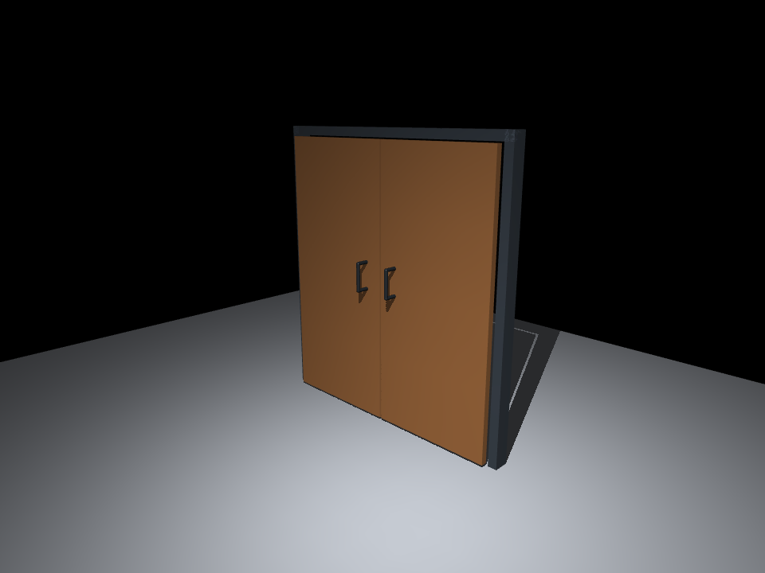

# dog-and-arm：M1＋Piper H 腿臂协同控制

本仓库使用M1四轮轮足、Piper H、官方夹爪与DaBai DC1腕相机。**当前先按开源SuperMimic完成标准迁移，以达到或接近论文指标为目标，单独保留结果供后续比较；之后才开发多模态/VLA与实机联合系统。** WM、可微动力学和H32 Actor–Critic属于当前B0。

**最新已结束轮为638fddc，标准接触仍未通过。** 五条seed0配置真实训练，gain32到H32-u200/345,268有效转移、Warp/native正式接触各0/10；其他四条u50 Warp各0/10。415条nominal均失败。它们保留官方核心、但action-rate坐标、ReturnSampler、实际replay调度等还需对齐，不能称已完全复现论文配方。

独立结果：[B0_STANDARD_TRANSFER_BASELINE.md](reports/B0_STANDARD_TRANSFER_BASELINE.md) · [可解析清单](results/b0/standard_baseline_20261123/baseline_manifest.json)。当前为未完成中间快照，最终候选尚缺。完整归一化tracking目标≥0.90、接近数值带≥0.88是本项目预登记的迁移指标，同时须过原物理门槛；不是把论文G1分母直接换成开门成功率。

下一轮优先实际配对验证官方动作率单位，再落实采样/调度和WM接触精度；依次完成接触、完整单门、多seed/H。[论文指标协议](docs/B0_PAPER_BASELINE_PROTOCOL.md) · [官方源码审查](docs/B0_OFFICIAL_IMPLEMENTATION_AUDIT_20261123.md) · [最新实验审查](reports/B0_STANDARD_ROUND_REVIEW_20261123.md) · [下一执行计划](docs/B0_STANDARD_TRANSFER_PLAN_20261123.md) · [启动词](prompts/B0_START.txt) · [目标差距](docs/GOAL_GAP_20261123.md) · [每日详细日志](DAILY_WORK_LOG.md)。本次文档发布没有新增实验。

P1–P6工程与B0-03无接触学习继续继承；540/546参考前馈、15,000动作BC和解析补偿的有效成绩单列保留，不替代标准主线。当前状态以[PROJECT_STATE.md](PROJECT_STATE.md)顶部为准。

**基础联合模型已生成：官方 M1 ZGWS＋Piper H＋双指夹爪＋名义腕部支架／相机。**提供可重建的组合 URDF/MJCF、桌面实时关节调试入口和被动单门组合场景。装配查看器仍是 **KINEMATIC_PREVIEW**；另有独立 P4 入口，固定底盘已从前侧拉门至 **59.963°**，从背侧推门至 **25.076°**。

**P6 自由底盘单门。** 安装板、两侧支座和 Piper H 沿机身前移 60 mm。采用 `rail_bridge_front60_v2` 和冻结控制 `86ade86`，本机 Linux 桌面复测前拉 60°、背推 25° 各 20/20 通过。初版背推 C20 驶近时左后轮碰柱，调整背侧航向后重跑整侧。旧版成绩和失败保存在分版本报告中。[完整结果](reports/P6_FREE_BASE_DOOR.md) · [逐案数值](results/p6/rail_bridge_front60_v2_20261120T133724Z/conditions.csv) · [桌面装配](docs/MOUNT_RAIL_BRIDGE.md)

自由底盘可用 `bash scripts/project_env.sh python scripts/p5_free_base.py --config config/p5_heading.yaml --live --video --hold-final` 查看站立、慢行、按 12° 航向转弯、伸臂行走和停车。 [P5 报告](reports/P5_FREE_BASE.md)

本机桌面装配检查已完成，并已显示 P4 固定基座动力学运行。结果和边界见 [P4 接触报告](reports/P4_FIXED_BASE_CONTACT.md)、[26 秒视频](results/p4/pull_20deg/contact.mp4) 和 [时序图](results/p4/pull_20deg/contact_timeseries.png)。实时装配说明见 [LIVE_DEBUGGING.md](docs/LIVE_DEBUGGING.md)。

生成过程、数值检查和限制见 [装配报告](reports/assembly_report.md)。

**2026-11-16 已完成 H0：Piper H＋DaBai DC1 实机联调。**已保存真实 RGB、原始深度、两路 CameraInfo、静止/慢动作/停止/夹爪联合记录，并验证相机正常重启。最终 240 s 静止记录约 30 Hz 图像、200 Hz 关节反馈；成功动作实测 J6 范围 1.962°。首次失败及后续 QoS/DDS 修正、RGB 畸变参数限制均见 [H0 报告](reports/H0_HARDWARE_REPORT.md) 和 [动作短片](results/hardware/h0/20261116_2051/evidence/motion_success/clip.mp4)。手眼与附件称重仍后置。

## 从创建文件夹开始

在 Linux 终端执行：

    mkdir -p "$HOME/robotics"
    cd "$HOME/robotics"
    git clone https://github.com/kaiwen123-yang/dog-and-arm.git
    cd dog-and-arm
    env -u PYTHONPATH -u PYTHONHOME /usr/bin/python3 scripts/init_workspace.py

接着在本目录打开 Codex，先读 **PROJECT_STATE.md** 和 **prompts/NEXT_RUN.txt**。当前学习策略进度见 **reports/B0_RECOVERY_REVIEW_20261123.md**，工程教师基准见 **reports/P6_FREE_BASE_DOOR.md**；H0 操作流程保留在 **docs/H0_RUNBOOK.md**。已有 Codex CLI 时可运行：

    codex

也可在 VS Code 打开此文件夹并使用已有 Codex 扩展。无需更换现有 Codex 配置。AGENTS.md 会提供项目规则，PROJECT_STATE.md 负责保存实际进度；后者是项目约定文件，需要按提示词读取。

如果本地已经有这个仓库，进入已有目录，查看 git status 后正常拉取和接着工作；不要再次 clone 到同名目录，也不要覆盖已有修改。

## 用户现在需要做什么

在已有工作区先检查 git status，再正常拉取，将 [B0_START.txt](prompts/B0_START.txt) 交给 Codex，从 `23c9068` 已审查代码和结果接续[标准迁移计划](docs/B0_STANDARD_TRANSFER_PLAN_20261123.md)。恢复 `results/b0/free_s0_cloud_servo_r2/checkpoint_001000.pt` 与 `results/b0/contact_s0_wm_held_r2/wm_002000.pt`，保留纯 tracking 接触 u1000 的负结果及 540/546 混合包作为对照。复用已完成接口、数据和后端诊断，有具体风险才回归；不重跑整套 B0-03/P6，不提前打开 H，不用新任务协议或自研控制方法替代标准迁移结论。现场恢复和可执行入口见 [NEXT_RUN](prompts/NEXT_RUN.txt)。

最新恢复轮的 AutoDL 独立树为 `/root/autodl-tmp/dog-and-arm-b0-recovery`；历史 B0 树为 `/home/kaiwen/research/dog-and-arm-b0-contact` 与 `/root/autodl-tmp/dog-and-arm-b0-contact`，运行前核实可用位置、进程和材料。主工作树 `/home/kaiwen/research/dog-and-arm` 的其他修改保留。B0 使用独立训练环境，当前执行范围仅在仿真中。

## H0：相机和机械臂联合运行

详细方案见 [HARDWARE_INTEGRATION.md](docs/HARDWARE_INTEGRATION.md)，启动提示词见 [HARDWARE_INTEGRATION.txt](prompts/HARDWARE_INTEGRATION.txt)。本轮按“复用原有环境→相机取流→静止联合采集→已有控制方式的小幅慢动作/夹爪变化→重启采集与报告”完成。

相机/状态采集与运动控制分开运行，保持唯一命令发送端；复用已有 pyAgxArm 接口，不重验机械臂、不自动运行旧完整抓放或 CPV demo。记录 RGB、原始深度、两路 CameraInfo、关节/夹爪反馈及时间信息。软件时间关联、手眼标定和视觉闭环分别记录。

H0 的实际接口已填入 `config/hardware_session.yaml`，结果位于 `results/hardware/h0/20261116_2051/evidence/`。成功动作记录含修正前的 RGB 成批到达，最终 DDS 配置只完成静止复核；不宣称硬件同步或新标定。复跑入口、进程分离及完整本地大录制的范围见 [H0_RUNBOOK](docs/H0_RUNBOOK.md)。

## Codex 模型首轮要完成什么

1. 检查实际 Linux/Python/ROS 环境，在项目 .venv 安装 MuJoCo 依赖。
2. 获取固定来源的 M1 ZGWS 和 Piper H 官方模型，生成源模型清单。
3. 处理 mesh 路径、M1 衍生 URDF 和 Piper 夹爪结构。首版 Piper visual 明确复用官方 collision STL，未转换 DAE 材质外观。
4. 根据官方几何与四张照片完成名义装配，生成组合 URDF 和 MJCF。
5. 交付整机正面、侧面、腕部局部与虚拟相机图；给出模型查看命令。

阶段说明见 docs/BUILD_PLAN.md，转换细节见 docs/MODEL_INTEGRATION.md，已核对的官方来源见 docs/SOURCES.md。

## 已有脚本与运行顺序

以下命令通常由 Codex 执行并处理真实报错；也可以在读完说明后手动运行：

    bash scripts/setup_env.sh
    bash scripts/project_env.sh .venv/bin/python scripts/fetch_sources.py
    bash scripts/project_env.sh .venv/bin/python scripts/inspect_sources.py
    bash scripts/project_env.sh .venv/bin/python scripts/build_assembly.py --stage all
    bash scripts/project_env.sh .venv/bin/python scripts/check_assembly.py
    bash scripts/project_env.sh .venv/bin/python scripts/live_assembly.py --watch

在 MuJoCo 窗口中：左右方向键选择关节，上下方向键微调；空格开合夹爪；F6 检查视角；F8 腕部/自由视角；F9 外观/碰撞专用凸包视图；F10 重载；F11 回到仿真 home；F12 退出。终端显示当前选择和数值。`--watch` 在 XML 成功重新生成后重开查看器；XML 修改失败会保留旧模型。

`config/assembly.yaml` 是安装关系入口。在另一终端修改参数后运行 `build_assembly.py --stage combined`；运行中的查看器会更新。只改 YAML 而不重建 XML 不会改变画面。

单体实时查看分别加 `--model sim/scenes/m1_preview.xml` 或 `--model sim/scenes/piper_preview.xml`；带静止被动单门的整机场景为 `sim/scenes/assembly_with_door.xml`。完整逐阶段流程见实时调试文档。

可选的运动学演示和离线证据：

    bash scripts/project_env.sh .venv/bin/python scripts/live_assembly.py --scripted-demo
    MUJOCO_GL=egl bash scripts/project_env.sh .venv/bin/python scripts/capture_assembly.py --video

二者都不调用 `mj_step`。离线图片／视频不能替代用户本机的实时开窗检查。

P4 固定基座接触复跑（仅仿真，默认保存到新的时间目录）：

    bash scripts/project_env.sh python scripts/p4_fixed_door.py --live --video

结果目录中的 `timeseries.csv` 可由 `scripts/plot_p4.py <结果目录>` 绘图。P4 场景使用独立固定根和专用把手高度；不代表 M1 具有站立控制。

原有被动门入口仍保留：

    bash scripts/project_env.sh .venv/bin/python scripts/build_doors.py
    bash scripts/project_env.sh .venv/bin/python scripts/view_model.py sim/scenes/door_single.xml

查看双门：

    bash scripts/project_env.sh .venv/bin/python scripts/view_model.py sim/scenes/door_double.xml

view_model.py 默认只做静态显示和 mj_forward，不运行无控制的整机动力学。显式添加 --simulate 才进行 mj_step。场景中的门是被动铰链，初始静止；门不会自行打开。

已用 MuJoCo 3.3.0 编译单门/双门，并分别从静止步进 2 s。下面是双门静态渲染，完整验证边界见 [准备验证记录](reports/KICKOFF_VALIDATION.md)。

无桌面环境时，可尝试显式选择本机可用的 EGL 渲染：

    MUJOCO_GL=egl bash scripts/project_env.sh .venv/bin/python scripts/view_model.py sim/scenes/door_double.xml --snapshot results/doors/double_closed.png

该截图命令不运行动力学。若本机 EGL 不可用，根据实际驱动报错处理，或使用桌面查看器；不要为此重装已有 CUDA/ROS。

## 目录用途

| 目录/文件 | 内容 |
| --- | --- |
| AGENTS.md | Codex 项目规则与用户偏好 |
| PROJECT_STATE.md | 当前完成情况、验证范围及下一步 |
| DAILY_WORK_LOG.md | 北京时间逐日详细工作、问题处理、实验结果与交接记录 |
| docs/B0_STANDARD_TRANSFER_PLAN_20261123.md | 当前官方核心机制的标准迁移、必要平台适配与验收计划 |
| reports/B0_RECOVERY_REVIEW_20261123.md | 最新恢复轮完整成绩、方法归因、证据边界与审查结论 |
| docs/GOAL_GAP_20261123.md | 距离 B0 与最终多模态/世界模型/实机目标的逐项差距 |
| results/b0/recovery_review_20261123/audit_summary.json | 最新轮 387 条结果覆盖、继承/遗漏、精确分母与视频审阅范围 |
| docs/B0_RECOVERY_PLAN_20261123.md、reports/B0_REVIEW_20261123.md | 前一恢复计划与审查，作为历史保留 |
| docs/B0_CONTACT_EXECUTION_PLAN.md | 已执行轮的历史计划与继续继承的任务/冻结门槛 |
| prompts/ | 首轮、续接、后续动力学阶段提示词 |
| docs/HARDWARE_INTEGRATION.md | H0 实机联调步骤、验收依据和接口核查 |
| config/hardware_session.yaml | H0 实测设备/驱动/流/时间域配置 |
| config/ | 来源版本、名义安装、门、观测配置 |
| materials/photos/ | 用户提供的四张腕部安装照片 |
| assets/accessories/ | 已提取的官方支架候选几何、来源与预览 |
| assets/converted/ | 按固定源重建的唯一命名网格，不提交重复大资产 |
| vendor/ | 脚本下载的上游源模型，默认不提交 |
| description/ | 衍生 M1、Piper H、组合 URDF 和名称映射 |
| sim/components/ | 被动门组件和后续机器人组件 |
| sim/robots/ | 组合机器人原生 MJCF |
| sim/scenes/ | 单体、整机、整机＋被动单门、单／双门场景 |
| controllers/ | 后续仿真控制器 |
| hardware/ | 本机相机 workspace/依赖；下载和编译目录不提交 |
| scripts/ | 可执行入口 |
| reports/、results/ | 阶段报告和必要实验结果 |

## 已决定的简化

- 原生 MuJoCo 为唯一仿真环境；只从智身官方仓库取资产。
- M1 背部安装参数先用明确的名义值，按网格碰撞关系调整。
- 相机/支架暂不贡献额外载荷，但保留视觉和碰撞；真实重量以后补。
- 腕部第一版输出理想对齐 RGB-D；真实 DC1 内参、双光心、噪声及手眼标定以后接入。
- 门无闭门器、无锁舌、无门电机；初期采用固定 U 形把手。
- 先单扇、后双扇；先固定基座验证接触，再释放 M1 基座完成移动操作。

## 仓库存储

本仓库是项目代码与阶段记录的保存位置。按有意义的可见调试节点提交并及时推送代码、配置、报告及必要小规模结果。无需另外制作本机压缩归档。vendor/、assets/converted/ 和 .venv 可按脚本重建，默认不提交；新拉取模型后先执行 fetch_sources.py 和 build_assembly.py，才能解析所引用的本地网格。四张实物照片已在仓库，无需重新下载或补拍。

源码引用和第三方资产许可见 THIRD_PARTY_NOTICES.md。

