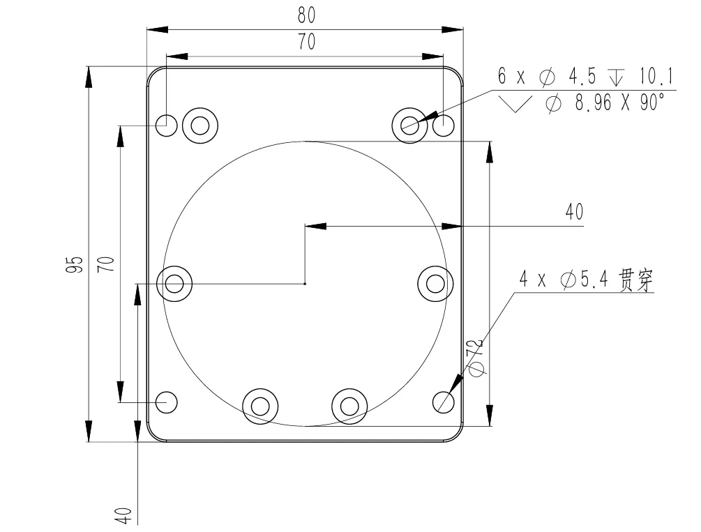

# M1 与 Piper H：双导轨跨接转接板

更新：2026-11-20（Asia/Shanghai）。用户决定后续仿真按下图的连接形式进行；随后指定Piper H官方手册核对孔位。

**已确定结构方案和接口参考；当前生成器仍是旧方块安装座，尚未完成新连接件的模型替换和本机可见验证。** 后续在现有生成器中落实，不重建整套机器人。

## 1. 用户选定的结构

- 转接板跨接M1背部两根安装导轨，Piper H原生底座固定在板上。
- 转接板下方留出机身盖板避让间隙，支承落在两侧安装面；中间不再用一个实体方块填满。
- 图中每排中间3孔、共6个M4孔作为当前项目的示例选孔方案；不是厂商规定的唯一选孔方式。
- 保持刚性链 `m1_base_link → m1_arm_mount → piper_base_link`，整机仍只有一个自由根。连接件固定于机身，不固定于世界。

图中的两排7孔、沿排60mm、排间154mm、M4深6mm，本轮按用户图记录，未重新独立核验M1厂家文件。坐标表以孔阵列自身为基准，不把图示中心自动当成M1或机械臂URDF原点。

## 2. Piper H孔位已经由官方资料确认

直接读取用户指定的 [《PIPER H 用户手册》](https://agilexsupport.yuque.com/staff-hso6mo/alxgtf/ay1awrn2hrhn1krg) 正文及嵌入安装图。

| 项目 | 官方H资料中的依据 | 采用方式 |
| --- | --- | --- |
| 四孔中心距 | §1.2性能参数与§2.4.1安装说明均为70×70mm | 可确定为Piper H接口参考，不再仅标PiPER-X待核 |
| 固定数量/螺钉 | 4个安装孔，使用M5螺钉 | 四孔布置用于转接板设计 |
| 四角孔型 | §2.4.1附图标注4×Ø5.4贯穿 | 仿真名义几何按此通孔标注 |
| 底座外轮廓 | 同一附图为80×95mm | 与70×70mm孔中心距分开 |

来源：[官方原图](https://cdn.nlark.com/yuque/0/2025/png/33709157/1767175387998-59ffc4b5-8070-4a90-8e1e-bfc62c6f6efe.png?x-oss-process=image%2Fformat%2Cwebp)。本仓库只保留这一安装图作为接口核查证据，来源及权利归AgileX。手册版本表为V.1.1.0、2026/1/25，页面内容更新时间为2026-10-22；本次读取日期为2026-11-20。

正文把孔称为“M5螺纹通孔”，而附图标为Ø5.4贯穿，存在孔型表述不一致。**孔距、数量和M5螺钉规格已确认；不能由正文这句话推断实物底座一定已有M5内螺纹。** 名义仿真按图表达通孔与螺钉，转接板承接螺纹是所选方案的设计假设，不是已完成的加工验证。

附图另有6个Ø4.5沉头孔，属于另一组孔，不能与四角安装孔混用。孔阵列中心、图示Ø72圆心和模型根坐标也不自动重合；生成器应明确安装基准变换。

上述数值及来源已结构化记录于 [mount_interface_reference.json](../config/mount_interface_reference.json)。该文件当前是参考数据，旧生成器尚不消费其中参数，不能仅因文件存在就声称模型已更换。

## 3. 下一次模型修改如何落实

在 `scripts/build_assembly.py` 中，将旧单一方块安装座换成跨接板及必要的两侧支承/安装几何，同时更新URDF与MJCF中的对应外形、碰撞和安装变换。复用已有Piper H底座，不重复附加第二个原生底座。

板外形、板厚、盖板间隙、沿导轨位置和臂安装高度分别参数化。图不按比例，不能按像素推尺寸；可以结合现有官方网格选取明确标注的名义值。图中两组孔的居中对齐只表达布置思路，不强制把机械臂移到M1几何中心。

保留安装座、相机/腕支架额外载荷 `omitted` 的既有阶段假设；不能让新增几何默认密度隐式增加质量。官方机器人本体惯性保持来源清楚。手眼、标定板和称重后置，不阻塞这次名义几何更新。

MuJoCo刚体任务阶段可以简化螺钉、螺纹和小孔碰撞，重点保留转接板外包络、板下间隙和臂对机身的相对位姿。当前不声称已验证连接件强度、螺钉载荷或真实承载能力。

## 4. 与正在推进的P6衔接

当前仓库已有旧安装座下的P6名义整任务 `mobile_01`，不得覆盖或重新标成新连接件验证。若旧版本条件组已经开始，让其按既定流程结束并保留；在下一个模型切换节点采用本方案。

切换时先在用户Linux桌面显示：两侧连接、板下间隙、原生底座、完整机械臂，以及碰撞几何。保持窗口可见，在另一终端重建，说明安装高度/偏移和碰撞外形实际变化。只补做这次连接件改动涉及的装配检查，不重新跑整套P0–P3或H0。

新几何完成后，用新的结果目录复跑一条名义连续单门任务，作为该安装版本的基准，再继续对应条件组。不同连接件或安装变换的结果单独标注，不混在同一组成功率中。后续顺序仍按最新 `PROJECT_STATE.md` 与 `NEXT_RUN.txt`，不倒退覆盖已完成的P6进度。
