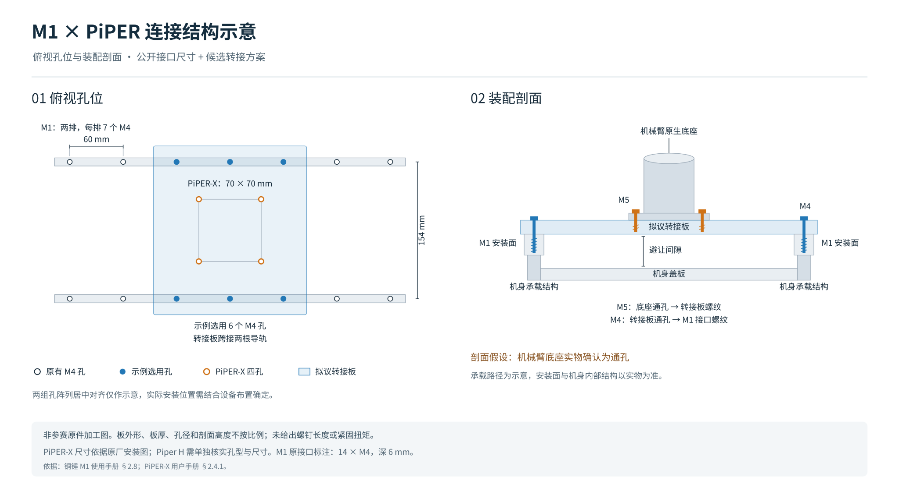
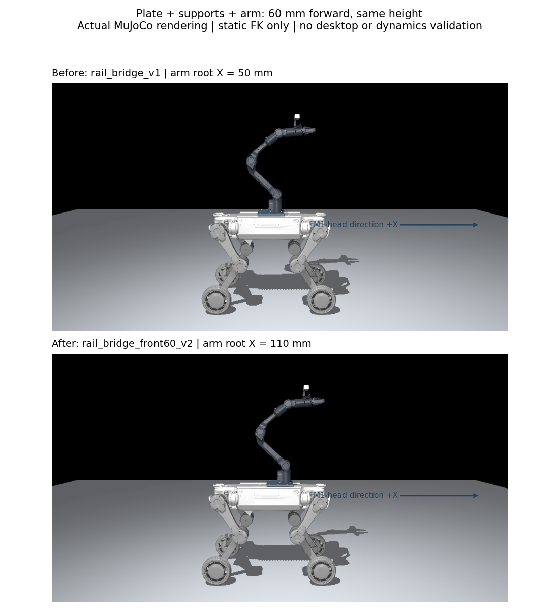

# M1 与 Piper H：双导轨跨接转接板

更新：2026-11-20（Asia/Shanghai）。用户决定后续仿真按下图的连接形式进行；随后指定Piper H官方手册核对孔位。

**当前组合 URDF 和 MJCF 已更新为向狗头前移 60 mm 的 rail_bridge_front60_v2，详见第 5 节；本机可见装配检查见第 6 节，单门推拉复测现按用户要求暂停。** 前一版本 rail_bridge_v1 已在本机 Linux 桌面用同一近景展示旧方块座与新板，再查看整臂和碰撞外形。[旧座](../results/assembly/rail_bridge_v1/old_block.png) · [新座](../results/assembly/rail_bridge_v1/bridge_exterior.png) · [碰撞](../results/assembly/rail_bridge_v1/bridge_collision.png) · [整机](../results/assembly/rail_bridge_v1/bridge_overview.png)

## 1. 用户选定的结构



- 转接板跨接M1背部两根安装导轨，Piper H原生底座固定在板上。
- 转接板下方留出机身盖板避让间隙，支承落在两侧安装面；中间不再用一个实体方块填满。
- 图中每排中间3孔、共6个M4孔作为当前项目的示例选孔方案；不是厂商规定的唯一选孔方式。
- 保持刚性链 `m1_base_link → m1_arm_mount → piper_base_link`，整机仍只有一个自由根。连接件固定于机身，不固定于世界。

图中的两排7孔、沿排60mm、排间154mm、M4深6mm，本轮按用户图记录，未重新独立核验M1厂家文件。坐标表以孔阵列自身为基准，不把图示中心自动当成M1或机械臂URDF原点。

## 2. Piper H孔位已经由官方资料确认

直接读取用户指定的 [《PIPER H 用户手册》](https://agilexsupport.yuque.com/staff-hso6mo/alxgtf/ay1awrn2hrhn1krg) 正文及嵌入安装图。

| 项目 | 官方H资料中的依据 | 采用方式 |
| --- | --- | --- |
| 四孔中心距 | §1.2性能参数与§2.4.1安装说明均为70×70mm | 可确定为Piper H接口参考，不再仅标PiPER-X待核 |
| 固定数量/螺钉 | 4个安装孔，使用M5螺钉 | 四孔布置用于转接板设计 |
| 四角孔型 | §2.4.1附图标注4×Ø5.4贯穿 | 仿真名义几何按此通孔标注 |
| 底座外轮廓 | 同一附图为80×95mm | 与70×70mm孔中心距分开 |


来源：[官方原图](https://cdn.nlark.com/yuque/0/2025/png/33709157/1767175387998-59ffc4b5-8070-4a90-8e1e-bfc62c6f6efe.png?x-oss-process=image%2Fformat%2Cwebp)。本仓库只保留这一安装图作为接口核查证据，来源及权利归AgileX。手册版本表为V.1.1.0、2026/1/25，页面内容更新时间为2026-10-22；本次读取日期为2026-11-20。

正文把孔称为“M5螺纹通孔”，而附图标为Ø5.4贯穿，存在孔型表述不一致。**孔距、数量和M5螺钉规格已确认；不能由正文这句话推断实物底座一定已有M5内螺纹。** 名义仿真按图表达通孔与螺钉，转接板承接螺纹是所选方案的设计假设，不是已完成的加工验证。

附图另有6个Ø4.5沉头孔，属于另一组孔，不能与四角安装孔混用。孔阵列中心、图示Ø72圆心和模型根坐标也不自动重合；生成器应明确安装基准变换。

上述数值及来源已结构化记录于 [mount_interface_reference.json](../config/mount_interface_reference.json)。生成器读取其中两组孔中心。沿导轨的名义基准、板尺寸、支承面和 Piper 孔组相对根的偏移见 [assembly.yaml](../config/assembly.yaml)。

## 3. rail_bridge_v1 的既有名义几何

坐标均在 M1 机身系中。Piper 原生底座原点从 [50, 0, 180] mm 降至 [50, 0, 94.5] mm。板长宽各 180 mm、厚 8 mm，板中心 x 为 10 mm。两支座各长 150 mm、宽 14 mm，位于 y = ±77 mm，分别从导轨承面延伸到板底。原生 Piper 法兰与四孔在官方碰撞 STL 上可见，孔阵列中心相对臂根 x 偏 −5 mm。板的视觉网格包含六个 M4 安装孔和四个承接 M5 的名义底孔，细螺纹省略。

板底 z 为 86.5 mm，盖板原始网格上表面约 72 mm，名义间隙 14.5 mm。MuJoCo 对原机身网格使用凸包接触，在板中心计算出的碰撞净空约 4.41 mm。板与两个支座用三个盒体参与碰撞，小孔与螺钉仅保留视觉细节。模型的安装座和腕部附件附加载荷均省略，整机名义质量 43.5371 kg。上述尺寸用于仿真，连接强度和实物净空仍未经测量。[几何数据](../results/assembly/rail_bridge_v1/geometry.json)

在已有官方资产的工作区执行以下命令。第一条同时恢复板网格及组合模型。桌面查看器支持 F6 查看全机，F9 切换碰撞显示。

```bash
bash scripts/project_env.sh python scripts/build_assembly.py --stage combined
bash scripts/project_env.sh python scripts/live_assembly.py --watch --mount-detail
```

2026-11-20 在用户桌面开窗后重建，近景对照使用相同相机重载旧、新 XML。对照窗口在新座加载后退出，重新打开当前模型完成碰撞与整机检查。独立 URDF/MJCF 的三组 FK 最大位置差为 2.6×10⁻¹⁶ m，最大旋转矩阵差为 9.9×10⁻¹⁶，腕部相机保持刚性。联合机器人保留一个自由根、23 个控制输入和一个夹爪耦合约束。[重载日志](../results/assembly/rail_bridge_v1/comparison.jsonl) · [显示检查日志](../results/assembly/rail_bridge_v1/inspection.jsonl) · [FK 结果](../results/assembly/rail_bridge_v1/kinematics.json)

## 4. P6 版本记录

旧座名义任务为 `results/p6/mobile_01`，20 例最终前拉清单与背推 `push_02` 也使用旧座。新座单独保存动力学结果并在每次运行的 config.json 写入安装版本与臂根坐标。[P6 报告](../reports/P6_FREE_BASE_DOOR.md)

## 5. rail_bridge_front60_v2：整套安装向狗头前移 60 mm

用户于 2026-11-20 要求板靠近狗头，并重新进行完整推拉测试。M1 机身前向为 +X：官方前腿 FAR/FBL 根坐标 X=+0.2698 m，后腿为 −0.2698 m；项目 `p6_base.py` 的正向行驶约定相同。按一个 60 mm 孔距移动整套板、支座和机械臂。

| 项目（M1 机身坐标） | v1 | front60_v2 |
| --- | --- | --- |
| 臂根 X / Z | 50 / 94.5 mm | 110 / 94.5 mm |
| 板中心 X | 10 mm | 70 mm |
| 两支座中心 X | 0 mm | 60 mm |
| 每排安装孔 X | −60 / 0 / 60 mm | 0 / 60 / 120 mm |
| 每排 7 孔中的选择（按 X 递增，1 起计） | 第 3 / 4 / 5 孔 | 第 4 / 5 / 6 孔 |
| 板长宽厚 | 180 × 180 × 8 mm | 相同 |
| 板底 Z | 86.5 mm | 相同 |

完整导轨阵列的 `rail_pattern_origin_xy_m` 仍为 [0,0]。生成器按所选孔 X 范围的中点布置支座，避免只移动板/臂而把支座留在原位。Piper 70 × 70 mm 孔组、板局部孔形、相机/夹爪相对关系均保持。默认附加载荷仍省略。



这张图是同一相机和 home 关节姿态的 MuJoCo 离线渲染，不是用户桌面截图。实际云端验证命令：

```bash
bash scripts/project_env.sh python scripts/build_assembly.py --stage combined
bash scripts/project_env.sh python scripts/check_assembly.py --report results/assembly/rail_bridge_front60_v2/kinematics.json
```

生成器及前拉/背推派生场景均编译成功；保持唯一自由根、23 个控制输入与单个夹爪耦合。三组 FK 最大位置差 2.457×10⁻¹⁶ m、最大旋转矩阵差 9.806×10⁻¹⁶。机身最高凸包面至板底的净空下界为 4.410643 mm；两侧导轨支承面高度仍匹配既有名义值。相同 home 姿态下，整机质心向 +X 移动 6.500053 mm，整机总质量 43.537064 kg 不变。这意味着前移会改变承重分配，旧版开门结果不能直接沿用。[模型记录](../results/assembly/rail_bridge_front60_v2/model_check.json) · [源网格计算](../results/assembly/rail_bridge_front60_v2/source_mesh_clearance.json) · [FK](../results/assembly/rail_bridge_front60_v2/kinematics.json)

本轮只完成代码/模型与离线静态检查，未执行 mj_step、用户桌面展示或新位置下的推拉门。接续 [MOUNT_FORWARD_PUSH_PULL.txt](../prompts/MOUNT_FORWARD_PUSH_PULL.txt)，先在 Linux 桌面确认前移，再前拉 60°/背推 25°及两侧各 C01–C20。所有新运行从实际模型读取 `mount_revision`，不要覆盖旧结果。

## 6. 本机 Linux 桌面前移检查
同日从 main 快进至 5cb8403，重建当前组合件后，在已打开的 MuJoCo 3.3.0 窗口再次重建并观察 XML 重载。近景可见底座紧固于跨轨板，碰撞视图显示简化板及支座，整机侧视显示 home 收臂姿态。碰撞距离按机身凸包、前腿代理和机械臂活动件（含腕附件）计算，距机身 92.420 mm，距前腿 260.216 mm，home 接触数为零。三个 FK 姿态最大位移差 2.457e−16 m、最大旋转矩阵差 9.806e−16。仅为真实桌面的运动学检查。
[板近景](../results/assembly/rail_bridge_front60_v2/local_desktop/mount.png) · [近景碰撞](../results/assembly/rail_bridge_front60_v2/local_desktop/mount_collision.png) · [收臂侧视](../results/assembly/rail_bridge_front60_v2/local_desktop/stow_side.png) · [收臂碰撞](../results/assembly/rail_bridge_front60_v2/local_desktop/stow_collision.png) · [事件、距离和 FK 数据](../results/assembly/rail_bridge_front60_v2/local_desktop/)
