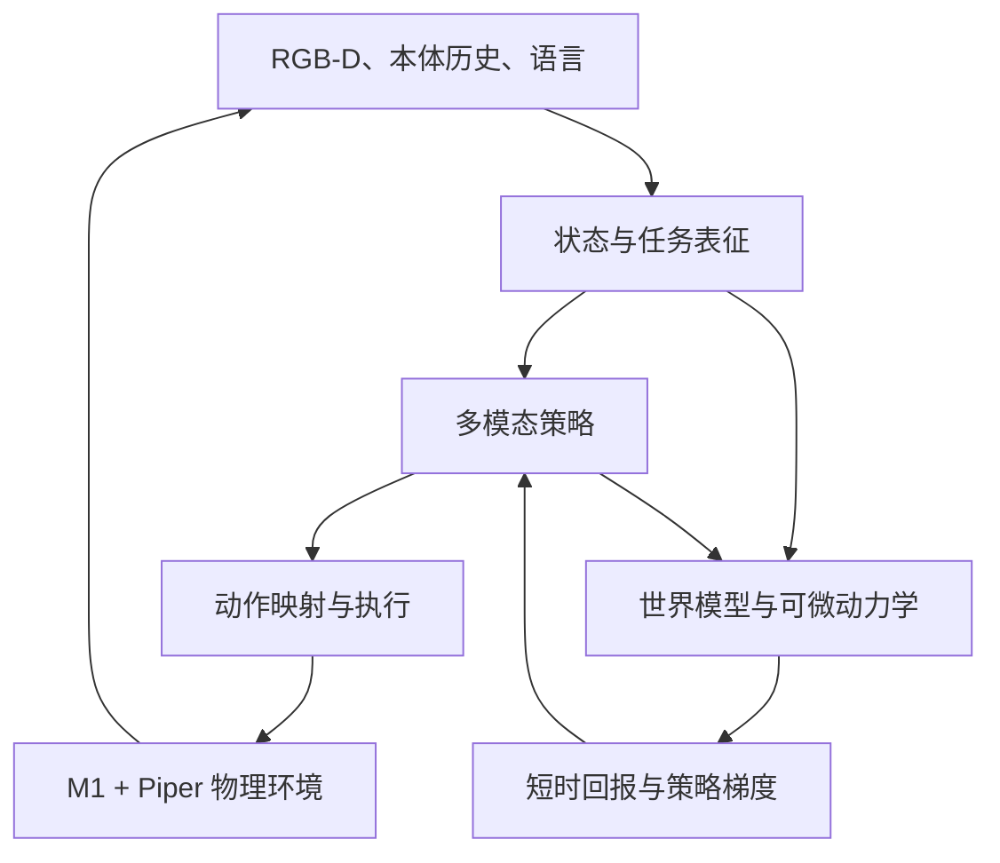

# 当前主线：多模态、世界模型与可微动力学的完整腿臂算法

更新：2026-11-25，北京时间。用户最新指定**现在直接推进本计划，桌面Piper部署由用户根据时间安排**。桌面实机、硬件在线和标定不阻塞当前算法与仿真。具体首轮按[MM-01集中计划](MULTIMODAL_MM01_EXECUTION_20261125.md)执行。MM-01 已完成 AutoDL 实训和原生全身评测，监督和 H32 分别为 0/12。桌面部署继续由用户择时安排。[首轮实测](../reports/MULTIMODAL_MM01_RESULTS.md)。

## 1. 保持原来的研究目标

最终系统在 **M1＋Piper H＋官方夹爪＋腕部 DC1** 上，使用**语言、腕部 RGB-D、本体反馈和历史**，完成移动、稳定、抓持、推拉、释放、收臂与退出，并逐步支持不同门位、遮挡、扰动和一种非门操作。第一期的固定臂成功只证明局部部署与接触能力，不能代替整机腿臂协同、多模态理解或泛化结果。

沿用仓库已有 [RESEARCH_ROADMAP](RESEARCH_ROADMAP.md) 的 R0–R8 定义。原始定义可在 [894d122 固定版本](https://github.com/kaiwen123-yang/dog-and-arm/blob/894d12206b3cbf517866eeb95f7b02ecae67d751/docs/RESEARCH_ROADMAP.md) 核对。这里改变阶段调度，不重新发明一套无来源的“官方 SuperMimic 流程”。后续新观测、损失、网络、任务接口和混合教师均按自研方法登记。

## 2. 系统数据流与梯度流

部署数据流为：腕部 RGB-D、关节/夹口/底盘反馈及历史形成当前状态或信念，语言给出任务条件，策略输出可执行动作或技能条件；真实交互数据再用于学习。

图中世界模型—回报—策略这条链是**训练中的模型内优化**，不是声称实机每拍都要在线反向传播。第一版部署仍使用冻结策略前向，实测闭环时延；在线规划如有收益再独立比较。

| 模块 | 第一个可实现版本 | 需要证明的能力 |
| --- | --- | --- |
| 多模态表征/状态估计 | 腕 RGB、深度有效值/mask、本体历史、相机运动和任务文本；形成对象相对状态与时序隐变量 | 遮挡/延迟时可维持有用状态；不读取仿真真值冒充感知 |
| VLA/策略 | 先做同动作定义的监督/模仿基线，再比较动作或技能/参考条件接口 | 指令确实改变任务行为，闭环能完成连续任务 |
| 世界模型 | 继承可运行的状态转移链，加入物体、接触、任务进展及隐状态；预测观测特征按实际需要加入 | 在真实物理数据上预测与动作相关的后果，而非只重建漂亮画面 |
| 可微动力学 | 世界模型内的机器人/对象物理转移部分，表达腿轮—臂—门的作用 | 模型内动作梯度对实际闭环有用，明确近似和接触误差 |
| SuperMimic 式短时优化 | 继承交互→replay→WM监督→模型内策略优化→再交互；以 H32 作为已有起点 | 相对同数据、同观测、未启用模型内优化的监督基线，任务收益可以复现 |

可微动力学不是额外并列一个重复预测相同状态的网络。训练 rollout 的后续状态和特征由模型生成或按明确估计规则更新，不读取真实未来 RGB-D/接触/门角。部署只用真实可得观测；仿真特权量可以作为有标签的教师/监督目标，不能混进学生输入。

## 3. 现在使用的资产与后续实测增量

现在直接使用已有全机物理环境、动作/时钟定义、参考与教师、旧混合策略、状态WM/H32学习链和H0采集记录。训练用RGB-D/文本接口需要在本轮实现，H0不充当完整接触示教。桌面完整动作、执行延迟和真实接触数据待用户日后产生后增量接入，不作为当前数据准备的先决条件。

数据同时保留 `commanded_action` 与实际发送命令、真实后继、episode/阶段/失败、控制器来源、时间戳和有效性。人工接管、参考前馈、教师控制和纯策略回合各有身份。实际没有采集的历史图像不补造；从仿真状态重渲得到的图像明确标为重渲合成数据，不伪装为实时传感器。

以后获得的桌面臂数据可训练视觉、夹爪/接触与臂局部动力学，**没有腿轮或底盘运动监督**。统一数据接口需用形态标识、动作映射和有效 mask；不能把不存在的底盘数据补零当成真实全身监督。当前主线直接使用全机物理采集。

## 4. R0–R8 的具体接续

| 工作段 | 集中完成的内容 | 交付与判断依据 |
| --- | --- | --- |
| R0：新方法定义 | 明确允许观测、参考来源、动作/技能接口、实际时钟、任务条件、训练和测试划分 | 可直接实现的接口表与首轮实验登记；保留旧 B0/混合方法各自身份 |
| R1/R2：环境与数据 | 将已有全机环境接入腕 RGB-D 时序、遮挡/延迟；采集成功、失败、恢复、不同门位/外观与负载 | 可训练的小型数据闭环先成立；按 episode 和场景划分，避免相邻帧泄漏 |
| R3：多模态策略基线 | 直接在全机单门任务建立 RGB-D＋本体＋语言的监督策略；日后可增量接入固定臂数据 | 原速完整闭环视频、逐场景成功与失败；先证明观测和指令有作用 |
| R4：感知与世界模型 | 与 R3 并行，继承 B0 学习链，加入对象/接触/隐状态估计及需要的不确定性 | 分接触模式的短/长窗预测、动作响应诊断与可接入的推理/训练接口 |
| R5：联合训练 | 先固定表征/部分 WM 做策略优化，再按证据交替或扩大联合梯度；加入真实交互更新 | 同数据/预算/观测的闭环提升与消融，不用模型回报代替物理成功 |
| R6：完整仿真验证 | 不同站位/几何、摩擦/负载、视角、未见组合与失败恢复；可行后扩双门及非门任务 | 冻结模型的分组统计、整段视频和未见场景失败集 |
| R7：整机实机适配 | 按用户硬件时间安排复用既有接口及届时可得的桌面数据，补齐当前安装的手眼、负载、相机运动、时延与底盘状态 | 从固定/驻车到移动全身的逐级真实验证；使用现有硬件和有效标定 |
| R8：完整多模态实机 | 指令条件下完成接近、稳定、抓门、推拉、释放、收臂、退出，逐步测恢复 | 同一回合真实连续证据、跨条件成功率及适用范围 |

R3/R4 使用同一数据约定并行，R5 集成；共享模型、动作表和主分支由一个集成任务负责。当前立即推进R0/R1/R2并准备R3/R4，不等待桌面收束；R7/R8硬件执行由用户后续安排。以成组工作段组成集中执行轮，在依赖就绪时贯通采集、训练和完整物理评测，不再把一次小修复独立当成一轮研究成果。

## 5. 第二期首轮应做到什么

首轮不追求把全部 R1–R8 一次跑完，目标是**一条真实的多模态学习闭环**：

1. 现在实现统一数据格式，在全机单门环境生成最小可训练 RGB-D/本体/语言数据，含成功与失败，训练/验证场景独立。
2. 语言至少对应可区分的真实任务选择，例如指定门/方向/目标状态；固定一条门轨迹旁边重复同一句话不能证明语言理解。先小任务集，不宣称通用能力。
3. 训练同动作接口的监督策略，直接运行完整物理任务，交付第一个多模态闭环视频和逐案结果。
4. 并行完成相同状态/动作接口的 WM 接触预测；模型在训练时使用可微短时展开，进行一次明确登记的“加入模型式优化/保持监督基线”对照。
5. 若监督策略尚不能闭环，先根据可观测信息、数据覆盖和执行差异修正，不把大规模模型优化当作掩盖输入错误的手段。

视觉/语言骨干优先复用现场可用且来源、许可和输入规格已核对的模型，按实际显存与推理时延选择。此计划不擅自指定一个新大模型、下载大数据或为另一个项目重装环境。

## 6. 比较设计与研究贡献

必须分别回答三个问题：多模态是否提供了有用的信息，世界模型优化是否产生实际收益，恢复移动底盘后是否体现全身协同。

| 对照 | 主要比较 |
| --- | --- |
| P6 工程教师、546 混合策略、桌面适配 | 能力来源与工程上限参考；披露额外参考/解析控制，不当作等信息公平算法比较 |
| 多模态监督策略 vs 同观测/数据的模型式优化策略 | WM 与短时梯度优化是否提高完整任务、样本效率和失败恢复 |
| 保持架构、去掉某一模态或打乱/替换指令的受控验证 | RGB、深度、语言各自实际作用；不把多模态文件存在当作已使用 |
| 全身策略 vs 同任务下的固定/分离控制比较 | 底盘和臂是否有效配合；对纯固定臂可达任务不夸大全身收益 |

开发时冻结比较规则和评价场景，报告全部尝试、训练/继承/回滚预算、额外数据及参考信息。研究结论需要多个独立训练 seed 和未见场景验证，但不把所有消融和大样本资格设为首个可用视频的前置工作。

旧 RefXY2 的 FP64 检查证明了诊断前向 JVP 在 TorchScript 四元数算子中丢失切向量，尚未完成修正后整条 H32 JVP 一致性，也没有证明训练核心错误。第一期前向部署不依赖这个诊断；R5 若使用 JVP，需要先完成相关实现核对。反向梯度和中心差分的已有结果保留，针对实际新目标做必要的数值/物理响应复核，不重开无边界排查。[已封存 FP64 结论](../results/b0/refxy2_pair_20261125/fp64/README.md)

## 7. RoboMIND 与实机几何的范围

当前主数据来自本平台仿真；一期/后续实机数据获得后再加入。RoboMIND 仍是可选辅助支线：核对实际子集的视角、模态、单位和许可后，用相同自采数据/划分做有无对照；无可重复收益就取消。缺全身/门/接触标签保持缺失，不给 WM 填造监督，不把公共数据当成实机标定或动力学适配替代品。

第二期要用腕部图像参与几何闭环时，再核对或完成当前装配的内参、RGB–depth关系、手眼和时间对齐。H0 的接收时间关联不等于曝光硬同步，固定桌面外参也不能直接套用到改变后的 M1 安装。实际存在的后续标定可复用，但要匹配设备与装配版本。[H0 限定结论](../reports/H0_HARDWARE_REPORT.md)

## 8. 最终成果与启动方式

第一期输出的是固定臂部署结果；第二期输出才是多模态/世界模型/可微优化的算法贡献及全身任务证据。最终保留独立的方法说明、数据版本、训练代码、推理包、原速完整仿真与实机视频、逐案统计、关键消融、失败分析和复现命令。新增算法不回填进旧标准 migration 的分数。

当前启动词：[MULTIMODAL_START](../prompts/MULTIMODAL_START.txt)。每轮读取现有仿真/学习资产和当前状态，桌面交付仅在已经产生时读取；先填写当轮具体数据规模、资源预算和评价清单再训练。本次不登记未经测吞吐的大规模计算额度，不把旧标准链未执行额度继承为新预算。
