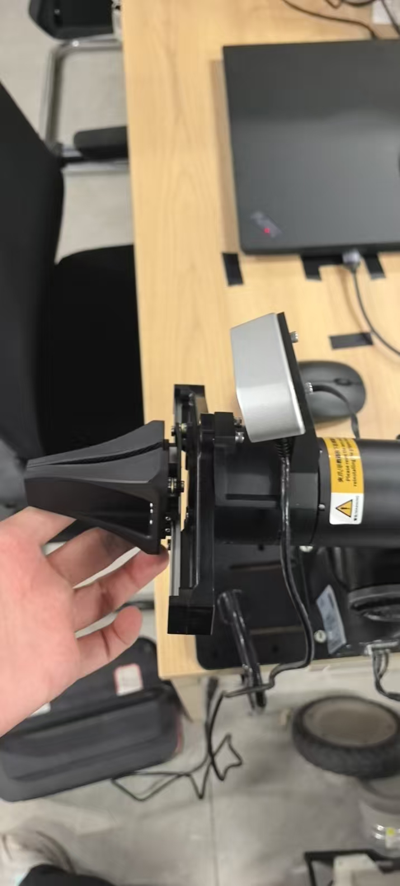

# 腕部照片与初始装配

用户提供的四张照片已原样放入 `materials/photos/`，足够开始第一版名义装配，不要求补拍后才继续。

| 文件 | 主要用途 |
| --- | --- |
| 01_front_oblique.jpg | 观察夹爪、相机与支架在正前方的整体关系 |
| 02_rear_mount.jpg | 观察相机背板、连接螺钉、支架下部与固定壳体 |
| 03_side.jpg | 观察弧形安装座、支架高度、相机和夹爪的前后关系 |
| 04_front.jpg | 对照相机大体朝向、左右位置和夹爪遮挡 |

## 能从照片确定的内容

支架位于末端的固定主体上，不连接两根活动夹指。相机在夹爪轴线旁侧，通过支架抬起，观察方向大致朝向夹爪前方。弧形座、加强筋、竖板开槽、相机安装板与提取的官方支架候选具有一致的主要结构。

具体 URDF 父 link 需要将照片中的固定壳体与 Piper H 官方几何划分对应后确定。先检查 `piper_gripper_base` 附近，不仅凭旧模型的 `link6` 名称直接复用旧安装变换。

## 当前不能从照片准确反推的内容

手机照片不直接给出精确安装位姿、光心、内参、实物质量、质心或惯量。当前全部按显式名义值处理；以后手眼标定或称重时再替换，不作为装配和基础动力学的阻塞条件。

支架 OBJ 已经是米单位、已应用原场景节点变换，不能再次乘 0.001。它的原点不是新 Piper H 的实测安装基准，也不能直接将旧组合 URDF 的视觉原点当作本次外参。

## P3 的具体操作

同时显示官方夹爪固定壳体与支架，依据弧形接触面、安装板和照片对齐；把结果作为 nominal 固定变换写入配置。使用简化相机外壳和虚拟相机观察门把手，检查夹爪开口改变时附件不随夹指运动。

相机外壳的尺寸字段是完整边长，不是安装平移。外壳、安装基准与光学坐标分别定义，不能自动等同。

当前附件额外载荷省略，视觉和碰撞保留。资料的零售工程修订尚未实测确认，在报告中如实记录即可。
